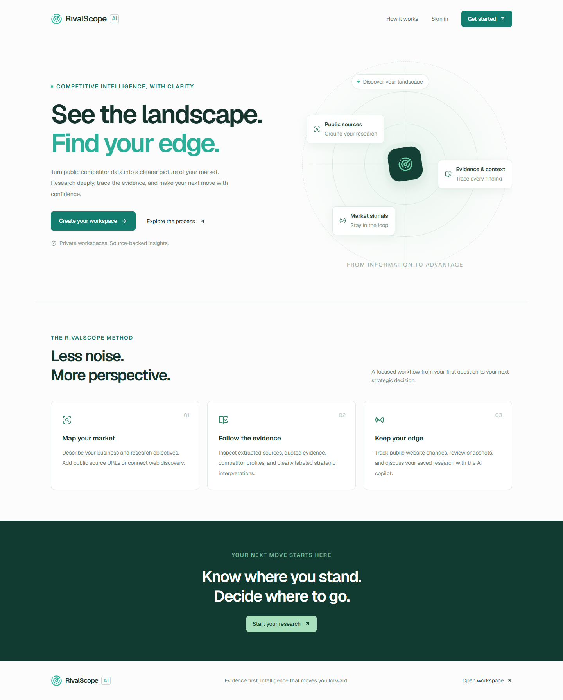
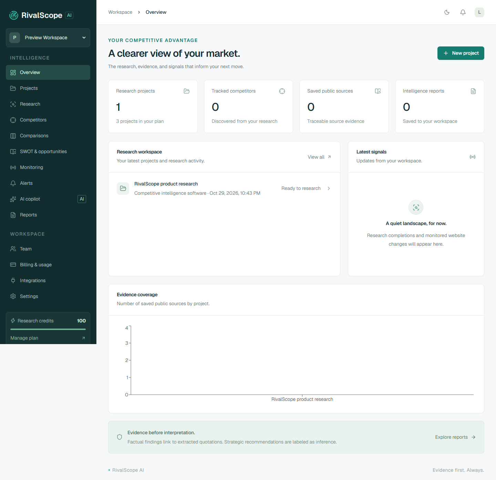

# RivalScope AI — বাংলা ব্যবহার নির্দেশিকা

**সংস্করণ:** বর্তমান স্থানীয় অ্যাপের জন্য · **হালনাগাদ:** ২৯ অক্টোবর ২০২৬

এই নির্দেশিকায় অ্যাপে এখন যে কাজগুলো করা যায়, সেগুলোর পথ দেখানো হয়েছে। মেনু ও বোতামের ইংরেজি নাম অপরিবর্তিত রাখা হয়েছে, যাতে স্ক্রিনের সঙ্গে মিলিয়ে কাজ করতে পারেন।

## আপনার জন্য কোন নির্দেশিকা?

| আপনি যা করতে চান | যে নির্দেশিকা পড়বেন |
| --- | --- |
| অ্যাকাউন্ট খুলতে, গবেষণা করতে, রিপোর্ট বুঝতে ও ডাউনলোড করতে | [সাধারণ ব্যবহারকারীর নির্দেশিকা](USER_MANUAL.md) |
| নিজের ব্যবসার গবেষণা পরিচালনা, দল গঠন, খরচ ও সিদ্ধান্ত দেখভাল করতে | [ব্যবসার মালিকের নির্দেশিকা](BUSINESS_OWNER_MANUAL.md) |
| পুরো প্ল্যাটফর্মের সেবা, ব্যবহারকারী প্রবেশাধিকার, প্ল্যান ও গবেষণার সমস্যা সামলাতে | [অ্যাডমিন ও পরিচালনা নির্দেশিকা](ADMIN_MANUAL.md) |

**দুই ধরনের অ্যাডমিন আলাদা:** একটি প্রতিষ্ঠানের `ADMIN` তার workspace পরিচালনা করেন। `Platform Administrator` পুরো RivalScope প্ল্যাটফর্মের অনুমোদিত অপারেটর। Workspace-এর `OWNER` বা `ADMIN` হলেই কেউ platform administrator হন না।

## প্রথমবারের সংক্ষিপ্ত পথ

১. অ্যাপ খুলুন → **Get started** → নাম, প্রতিষ্ঠানের নাম, ইমেইল ও পাসওয়ার্ড দিন।

২. ইমেইলের verification link খুলে **Continue** চাপুন।

৩. **Projects → Create project** দিয়ে ব্যবসার বিবরণ লিখুন।

৪. **Research**-এ project বেছে উদ্দেশ্য ও public source URL দিন।

৫. **Estimate & start research** চাপুন → credit estimate দেখুন → সম্মতি দিন।

৬. **Research activity**-তে অগ্রগতি দেখুন → শেষ হলে findings, supporting sources ও report দেখুন।

৭. **Reports** থেকে **PDF**, **Word**, **JSON** বা **Markdown** ডাউনলোড করুন।

## স্থানীয় পরীক্ষামূলক পরিবেশের ঠিকানা

| সেবা | ঠিকানা | কার কাজে লাগে |
| --- | --- | --- |
| অ্যাপ | [http://localhost:3000](http://localhost:3000) | সবাই |
| স্থানীয় ইমেইল inbox | [http://localhost:8025](http://localhost:8025) | নিজের verification/reset/invitation email দেখতে |
| API reference | [http://localhost:4000/api/docs](http://localhost:4000/api/docs) | অ্যাডমিন ও developer |
| API readiness | [http://localhost:4000/api/health/ready](http://localhost:4000/api/health/ready) | সেবা চলছে কি না দেখতে |

`localhost` মানে অ্যাপ চালানো কম্পিউটার। অন্য কম্পিউটার বা ফোন থেকে এই একই ঠিকানা ব্যবহার করে আপনার কম্পিউটারের অ্যাপ খোলা যায় না। Hosting হলে প্রতিষ্ঠানের দেওয়া আসল ওয়েব ঠিকানা ব্যবহার করবেন। স্থানীয় Mailpit inbox-ও production customer inbox নয়।

## বর্তমান সুবিধার অবস্থা

| অবস্থা | সুবিধা |
| --- | --- |
| বর্তমান অ্যাপে আছে | MFA ও recovery codes, session/profile settings, privacy export/deletion, source-based research, feature/pricing matrix, positioning chart, চার ধরনের report export, expiring share links, project notes/participants/bookmarks, ownership transfer, notification preferences, webhook/key management, platform administration |
| অতিরিক্ত setup প্রয়োজন | Google OAuth; Tavily automatic discovery; Stripe checkout/portal; Slack/Discord incoming webhooks; production SMTP ও telemetry |
| Credentials ছাড়া পরীক্ষা | আলাদা test database, deterministic provider fixtures এবং স্পষ্টভাবে চালু করা development billing sandbox; এগুলো বাস্তব payment বা live discovery-এর প্রমাণ নয় |
| Live চালুর আগে | Google/Tavily/Stripe credentials ও account configuration, provider sandbox acceptance, production HTTPS/SMTP/secrets এবং deployment smoke পরীক্ষা |

কোনো provider-এর পাশে **Configured** দেখালে প্রয়োজনীয় configuration আছে বোঝায়; তা দিয়ে live request সফল হয়েছে বা quota আছে—এমন নিশ্চয়তা পাওয়া যায় না।

## ছবি দেখে চিনে নিন

## সংরক্ষণ ও প্রিন্ট

একই ফোল্ডারের `index.html` ব্রাউজারে খুললে পড়ার উপযোগী সংস্করণ পাওয়া যাবে। একসঙ্গে তিনটি নির্দেশিকা পড়তে `RIVALSCOPE_MANUAL_BN.html` খুলুন। প্রস্তুত PDF হলো `RIVALSCOPE_MANUAL_BN.pdf`। অ্যাপের গবেষণা report এবং এই ব্যবহার নির্দেশিকা আলাদা নথি।
