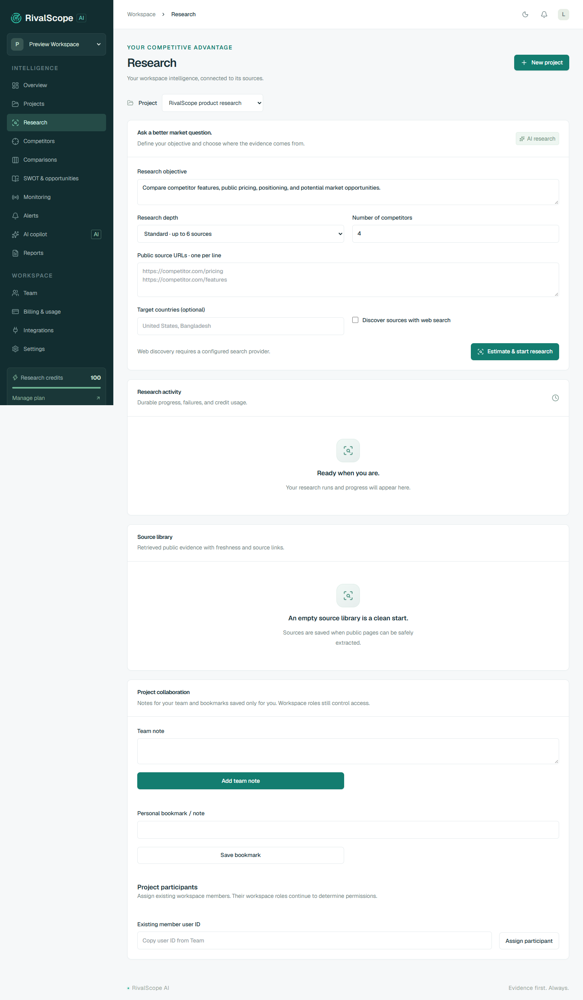

# সাধারণ ব্যবহারকারীর নির্দেশিকা

**RivalScope AI · বাংলা · ২৯ অক্টোবর ২০২৬**

এটি গবেষক, analyst, editor, viewer এবং নতুন ব্যবহারকারীদের জন্য। আপনার workspace role অনুযায়ী কিছু কাজ অনুমোদিত নাও হতে পারে। [ভূমিকা ও অনুমতির তালিকা](BUSINESS_OWNER_MANUAL.md) ব্যবসার মালিকের নির্দেশিকায় আছে।

## ১. অ্যাকাউন্ট খোলা ও প্রবেশ

### নতুন অ্যাকাউন্ট

১. অ্যাপের হোমপেজে **Get started** বা **Create your workspace** চাপুন।

২. ফর্মে লিখুন:

| ঘর | কী লিখবেন |
| --- | --- |
| Your name | আপনার নাম; অন্তত ২ অক্ষর |
| Workspace name | প্রতিষ্ঠানের বা দলের নাম; অন্তত ২ অক্ষর |
| Work email | যে ইমেইল দিয়ে অ্যাকাউন্ট ব্যবহার করবেন |
| Password | অন্তত ১২ অক্ষরের পাসওয়ার্ড |

৩. **Create workspace** চাপুন। অ্যাকাউন্ট তৈরি হলে dashboard খুলবে এবং আপনি নতুন workspace-এর `OWNER` হবেন।

৪. নিজের ইমেইলে verification বার্তা দেখুন। বর্তমান স্থানীয় setup-এ [Mailpit inbox](http://localhost:8025) খুলে নিজের প্রাপকের ইমেইল মিলিয়ে বার্তাটি খুঁজুন।

৫. verification link খুলুন → **Verify your email** অংশে **Continue** চাপুন। সফল বার্তা পেলে workspace-এ ফিরে যান।

প্রথম verification link সাধারণত ২৪ ঘণ্টা কার্যকর। **Resend email** দিয়ে পাওয়া নতুন link এক ঘণ্টা কার্যকর এবং আগের অব্যবহৃত verification link বাতিল হয়।

### আগে থেকেই অ্যাকাউন্ট থাকলে

**Sign in** চাপুন → **Work email** ও **Password** লিখুন → **Sign in** চাপুন। Session শেষ হয়ে গেলে আবার sign in করতে হবে।

### পাসওয়ার্ড ভুলে গেলে

১. **Sign in** পাতায় নিজের ইমেইল লিখুন।

২. **Forgot your password?** চাপুন।

৩. ইমেইলের reset link খুলে অন্তত ১২ অক্ষরের নতুন password দিন → **Continue**।

৪. নতুন password দিয়ে আবার sign in করুন। Password reset হলে আগের সব session বাতিল হয়। Reset link এক ঘণ্টা কার্যকর এবং একবারই ব্যবহারযোগ্য।

## ২. কোন মেনুতে কী পাবেন

| মেনু | এখানে যে কাজ করবেন |
| --- | --- |
| Overview | Project, competitor, public source ও report-এর সংখ্যা; সাম্প্রতিক activity |
| Projects | নতুন গবেষণার project তৈরি, project খোঁজা ও খোলা, অনুমতি থাকলে archive |
| Research | গবেষণার উদ্দেশ্য/source দেওয়া, credit estimate, অগ্রগতি, findings ও source library |
| Competitors | গবেষণায় পাওয়া প্রতিযোগী ও তাদের direct/indirect classification |
| Comparisons | Feature, pricing, positioning, sentiment, technology ও news findings দেখা/খোঁজা |
| SWOT & opportunities | Strength, weakness, opportunity, threat এবং অন্যান্য strategic interpretation |
| Monitoring | Public page পর্যবেক্ষণ, check interval ও পরিবর্তিত text দেখা |
| Alerts | Research completion ও website change notification; **Mark read** |
| AI copilot | নির্বাচিত project-এর সংরক্ষিত evidence নিয়ে প্রশ্ন |
| Reports | সম্পন্ন গবেষণার report export |
| Team | অনুমতি থাকলে member invitation, role ও member management |
| Billing & usage | অনুমতি থাকলে plan, available/reserved credit ও লেনদেন |
| Integrations | অনুমতি থাকলে provider setup status, API key তৈরি/বাতিল |
| Settings | অনুমতি অনুযায়ী workspace preferences; password reset ও সব device থেকে logout |

Sidebar-এর উপরের workspace selector দিয়ে প্রতিষ্ঠান বদলাতে পারবেন। কিছু পাতার **Project** selector দিয়ে কোন project-এর তথ্য দেখছেন তা ঠিক করুন। Mobile-এ sidebar-এ মূলত icon দেখা যায়; একই ক্রমে মেনুগুলো থাকে। উপরের চাঁদ/সূর্য icon দিয়ে theme বদলানো যায়।

শূন্য সংখ্যা বা empty state মানে ওই workspace/project-এ এখনও সংশ্লিষ্ট তথ্য নেই। এগুলো বাজারের কোনো প্রতিষ্ঠানের অবস্থা সম্পর্কে দাবি নয়।

## ৩. প্রথম project তৈরি

**কোথায় যাবেন:** **Projects**

১. **Create a research project** ফর্ম খুলুন।

২. **Project name**-এ গবেষণার নাম দিন। যেমন: `আমাদের customer support পণ্যের বাজার`।

৩. **Industry**-তে ব্যবসার খাত লিখুন। এটি ঐচ্ছিক।

৪. **Business description**-এ অন্তত ২০ অক্ষরে আপনার পণ্য, গ্রাহক ও কাজটি ব্যাখ্যা করুন।

উদাহরণ:

> আমরা ছোট অনলাইন ব্যবসার জন্য customer support software তৈরি করি। একই জায়গা থেকে গ্রাহকের প্রশ্নের উত্তর দেওয়া ও দলের কাজ ভাগ করাই মূল সুবিধা। বাংলাদেশ ও ইংরেজিভাষী ছোট দলকে লক্ষ্য করছি।

৫. চাইলে **Company website (optional)**-এ পূর্ণ `https://` ঠিকানা দিন।

৬. **Create project** চাপুন। তৈরি হলে সেই project-এর Research পাতা খুলবে।

**দেখতে পাবেন:** Project selector-এ আপনার project; শুরুতে research/source/report নাও থাকতে পারে। Project তৈরি করা মাত্র গবেষণা শুরু হয় না এবং কোনো competitor সংখ্যা বানিয়ে দেখানো হয় না।

## ৪. গবেষণা শুরু

**কোথায় যাবেন:** **Research → Project নির্বাচন**

### ফর্ম পূরণ

| ঘর | কী করবেন |
| --- | --- |
| Research objective | কী জানতে চান লিখুন; ১০–২০০০ অক্ষর |
| Research depth | **Standard** বা **Deep** নির্বাচন করুন |
| Number of competitors | ১–৮-এর মধ্যে লক্ষ্যসংখ্যা দিন; evidence কম হলে ফলও কম হতে পারে |
| Public source URLs · one per line | প্রতি লাইনে একটি পূর্ণ public URL; নিজে সর্বোচ্চ ৮টি URL দিতে পারেন |
| Target countries (optional) | একাধিক দেশ হলে কমা দিয়ে লিখুন; সর্বোচ্চ ৫টি |
| Discover sources with web search | Automatic discovery দরকার হলে চালু করুন; Tavily setup থাকতে হবে |

উদ্দেশ্যের উদাহরণ:

> দেওয়া public page-গুলোর ভিত্তিতে ছোট ব্যবসার customer support পণ্যগুলোর feature, প্রকাশিত pricing ও positioning তুলনা করো। যে দাম বা তথ্য পাওয়া যায় না তা স্পষ্ট করো। সম্ভাব্য differentiation-কে inference হিসেবে আলাদা দেখাও।

বর্তমান পরিবেশে Tavily credential দেওয়া হয়নি। তাই প্রথম গবেষণায় **Discover sources with web search বন্ধ রাখুন**, এবং পরিচিত competitor-এর আসল pricing/features page-এর public URL দিন। `competitor.com` বা `example.com` লেখা placeholder-কে বাস্তব competitor evidence হিসেবে ব্যবহার করবেন না।

Standard-এ সর্বোচ্চ ৬টি এবং Deep-এ সর্বোচ্চ ১২টি source URL প্রক্রিয়াকরণের সীমা আছে। নিজে দেওয়া URL-এর সীমা ৮টি; discovery চালু থাকলে অতিরিক্ত URL পাওয়া যেতে পারে। সব URL সফলভাবে extract হবে—এমন নিশ্চয়তা নেই।

### Estimate দেখে শুরু

১. **Estimate & start research** চাপুন।

২. কত credit reserve হবে, confirmation-এ দেখুন।

৩. শুরু করতে সম্মতি দিন; না চাইলে confirmation বাতিল করুন।

৪. **Research queued** বার্তা পেলে নিচের **Research activity** দেখুন। বারবার submit করবেন না; নতুন submit নতুন run তৈরি করতে পারে।

বর্তমান হিসাব:

| গবেষণা | Discovery বন্ধ | Discovery চালু |
| --- | --- | --- |
| Standard | ২১ credits | ২৪ credits |
| Deep | ২৭ credits | ৩০ credits |

এগুলো অ্যাপের বর্তমান product credit unit, টাকা বা provider-এর API খরচ নয়। ভবিষ্যৎ সংস্করণে policy বদলাতে পারে; confirmation-এর সংখ্যাই অনুসরণ করবেন।

### অগ্রগতি বোঝা

গবেষণা সাধারণত **plan → search → extract → analyze → catalog → verify → report** ধাপে চলে। Catalog-এ published products/features/pricing সাজানো হয়; verify-তে আলাদা AI evidence review হয়। Discovery বন্ধ থাকলেও search ধাপটি নিজে দেওয়া URL গোছায়; নতুন web search করে না।

| Status | অর্থ ও করণীয় |
| --- | --- |
| queued | কাজ সারিতে আছে; কিছুক্ষণ অপেক্ষা করুন |
| running | কাজ চলছে; activity দেখে অপেক্ষা করুন |
| completed | ফল প্রস্তুত; report ও findings দেখুন |
| failed | Error পড়ুন; source/setup সমস্যা ঠিক করে প্রয়োজন হলে নতুন run দিন |
| cancelled | কাজ বন্ধ হয়েছে; ব্যবহৃত credit কাটা হতে পারে, অব্যবহৃত reservation ছাড়ে |

চলমান run বন্ধ করতে **Cancel run** চাপুন। **Cancelling…** মানে অনুরোধ গেছে; বর্তমান ধাপ বা network request শেষ হতে কিছু সময় লাগতে পারে। এক workspace-এ একসঙ্গে সর্বোচ্চ ৩টি active run অনুমোদিত।

## ৫. ফলাফল যাচাই

**Research → Latest report / Source library**, **Comparisons** এবং **SWOT & opportunities** দেখুন। Findings-এর search box দিয়ে খুঁজুন এবং category selector দিয়ে ধরন বাছুন। **Supporting sources** খুলে quotation ও মূল page-এর link দেখুন।

| Label | কী বোঝায় |
| --- | --- |
| PARTIALLY_VERIFIED | উদ্ধৃতিটি পাওয়া source text-এর সঙ্গে মিলেছে; পুরো দাবির অর্থ বা সত্যতা স্বাধীনভাবে যাচাই করা হয়েছে—এমন নয় |
| INFERENCE | উৎসের ভিত্তিতে AI-এর ব্যাখ্যা, বিশ্লেষণ বা সম্ভাব্য কৌশল |
| UNVERIFIED | যাচাই নিশ্চিত নয় |
| VERIFIED | যাচাইকৃত হিসেবে চিহ্নিত; বর্তমান automatic research সাধারণ factual finding-কে এই label দেয় না |
| DISPUTED | তথ্য নিয়ে বিরোধ/অনিশ্চয়তা আছে; label থাকলে মূল source পর্যালোচনা করুন |

`Direct`/`Indirect` competitor classification-ও AI-এর interpretation। Executive summary, competitor description ও strategic recommendation সরাসরি যাচাইকৃত market fact হিসেবে ধরে নেবেন না।

Source library-তে retrieval time দেখুন। সেটি page সংগ্রহের সময়; page-এর প্রকাশের তারিখ বা ভবিষ্যতেও তথ্যটি অপরিবর্তিত থাকবে—এমন নিশ্চয়তা নয়। **Methodology & evidence limitations**-এ ব্যর্থ source ও তথ্যের ঘাটতি পড়ুন।

**Comparisons** পাতায় side-by-side feature/pricing matrix ও category-ভিত্তিক findings আছে। একই project-এ একাধিক run থাকলে finding list-এ আগের run-এর তথ্যও থাকতে পারে; সর্বশেষ run-এর নির্দিষ্ট report দরকার হলে সেই report export করুন।

## ৬. Report ডাউনলোড

১. **Reports** মেনু খুলুন।

২. Report-এর title ও সময় মিলিয়ে নিন।

৩. **JSON** চাপলে structured report; **Markdown** চাপলে পড়ার উপযোগী text report ডাউনলোড হবে।

৪. Research পাতার **Latest report** থেকেও export করতে পারেন।

**PDF**, **Word**, **JSON** ও **Markdown**—চার ধরনের export আছে। PDF/Word-এ findings, supporting quotations, source URL, retrieval time ও limitations থাকে। Download করা report-এ workspace research থাকে; বাইরে দেওয়ার আগে দেখে নিন।

Edit permission থাকলে report-এর **Share this report** খুলুন। **Workspace members** বাছলে অনুমোদিত সদস্যকে sign in করতে হবে। **External link holders** বাছলে confirmation দেওয়ার পরে বাইরের মানুষ link দিয়ে report পড়তে পারবেন। Expiry ১–৩০ দিন; চাইলে অন্তত ১২ অক্ষরের password দিন। নতুন link সঙ্গে সঙ্গে copy করুন। **Revoke link** দিলে পুরোনো link বন্ধ হয়ে যায়।

## ৭. AI copilot ব্যবহার

**কোথায় যাবেন:** **AI copilot → Project নির্বাচন**

১. আগে ওই project-এ research চালিয়ে evidence সংরক্ষণ করুন।

২. **New conversation** চাপুন বা বাম পাশ থেকে পুরোনো conversation খুলুন।

৩. নিচের ঘরে প্রশ্ন লিখে তীর বোতাম চাপুন।

উদাহরণ: `প্রকাশিত Starter plan-এর দামে কী পার্থক্য আছে? সংশ্লিষ্ট quotation দেখাও।`

৪. উত্তর, citation ও limitations পড়ুন। Saved evidence-এ না থাকলে AI-এর কাছ থেকে নিশ্চিত বাজারের তথ্য আশা করবেন না।

প্রতি সফল সংরক্ষিত source-backed response-এর বর্তমান charge ২ credits। প্রাসঙ্গিক evidence না পেলে সেটি জানাতে পারে। বর্তমান retrieval মূলত text matching করে; বাংলা প্রশ্নে ফল প্রাসঙ্গিক না হলে source-এ থাকা `pricing`, `features`, product name-এর মতো keyword যোগ করে চেষ্টা করুন।

## ৮. Monitoring ও Alerts

১. **Monitoring** খুলুন → **Research project** বাছুন।

২. **Public page URL**-এ public pricing, features বা announcement page দিন।

৩. **Check every**-তে ৬ ঘণ্টা, ২৪ ঘণ্টা বা ৭ দিন নির্বাচন করুন।

৪. **Create monitor** চাপুন। Worker সাধারণত এক মিনিটের মধ্যে schedule মিলিয়ে নেয়; প্রথম check সম্পন্ন হওয়ার আগে **Not yet checked** দেখা স্বাভাবিক।

৫. পরিবর্তন হলে monitor-এর **Content changed** খুলে **Previous snapshot** ও **Current snapshot** তুলনা করুন।

৬. **Alerts**-এ notification পড়ুন; প্রয়োজন হলে **Mark read** চাপুন।

প্রতি সফল check-এর বর্তমান খরচ ১ credit; page না বদলালেও check সফল হলে charge হয়। এটি public text পরিবর্তন শনাক্ত করে—অবশ্যই pricing change হয়েছে বা ব্যবসায়িক গুরুত্ব বেশি—এমন সিদ্ধান্ত নিজে থেকে দেয় না। **Pause** দিয়ে থামান; **Resume** দিয়ে আবার enabled করুন। Credits/subscription সমস্যা থাকলে enabled দেখালেও schedule check নাও করতে পারে; মালিককে জানান।

## ৯. Sign out ও project archive

Desktop-এ sidebar-এর নিচের logout icon দিয়ে বর্তমান session থেকে বের হন। **Settings → Sign out all devices** দিলে এই device-সহ সব session বন্ধ হবে।

**Projects → Edit project** থেকে নাম, business description, industry, website ও target market বদলান। Archive করতে সংশ্লিষ্ট project-এর **× icon → confirmation** ব্যবহার করুন। আপনার edit অনুমতি থাকতে হবে। Active research থাকলে আগে cancel করে শেষ হতে দিন। **Archived projects → Restore project** দিয়ে ফিরিয়ে আনতে পারেন; plan limit মানতে হবে এবং monitors আলাদা করে enable করতে হবে।

## ১০. নতুন security ও collaboration সুবিধা

**Settings → Your profile → Save profile** দিয়ে display name বদলান। **Active sessions**-এ নিজের ও অন্য browser-এর session দেখুন; **Revoke** দিয়ে বন্ধ করুন। নিজের session বন্ধ করলে আবার sign in করতে হবে।

**Settings → Two-step verification**-এ current password দিয়ে **Set up authenticator** চাপুন। Authenticator app-এ setup key যোগ করে time-based ছয় সংখ্যার code নিন। **Verify & enable MFA** চাপুন। দেখানো recovery codes নিরাপদে রাখুন—প্রতিটি একবার ব্যবহার করা যায় এবং পরে একই তালিকা আর দেখা যায় না। Login-এ password-এর পরে authenticator অথবা recovery code লাগবে। **Replace recovery codes** দিলে পুরোনোগুলো বাতিল হয়। MFA চালু/বন্ধ করলে অন্য session-গুলো বন্ধ হয়।

Google OAuth configured থাকলে login-এর Google button ব্যবহার করতে পারবেন। আগে password দিয়ে account খুলে থাকলে **Settings → Google sign-in → Connect Google** থেকে একই email-এর Google account যুক্ত করুন। Credential setup না থাকলে পরিষ্কার setup message দেখাবে।

**Research → Project collaboration**-এ team note, ব্যক্তিগত bookmark ও participants পাবেন। Team note দল দেখতে পারে; personal bookmark শুধু নিজের। Participant assignment workspace role বদলায় না এবং project-কে private করে না।

**Comparisons**-এ project ও competitor নির্বাচন করুন। Feature-এর quotation ও pricing source খুলে দেখুন। প্রকাশিত তথ্য না থাকলে gap দেখাবে; অনুমান করে দাম বসানো হয় না। Chart-এ compatible monthly prices ও documented feature count দেখা যায়—এটি market share বা product quality score নয়। Edit permission থাকলে selection-এর নাম দিয়ে comparison save করতে পারবেন।

**Settings → Email notification preferences**-এ instant, daily বা weekly বেছে save করুন। **Alerts → Mark read** শুধু নিজের read state বদলায়। Workspace owner/admin **Integrations** থেকে Slack/Discord incoming webhook যুক্ত করতে পারেন।

**Alerts → Watch phrase rules**-এ monitor, rule name, exact phrase, appeared/disappeared condition এবং নিজের priority বেছে **Create alert rule** চাপুন। Monitoring-এর পর পরবর্তী snapshots-এ phrase নতুন করে আসা বা চলে গেলে alert হবে। এটি literal text rule; business change নিশ্চিত করার জন্য snapshot দেখুন। Rule pause/enable করা যায়। Delete করলে তার matched history-ও মুছে যায়—confirmation পড়ে সিদ্ধান্ত নিন।

Owner ও billing manager **Billing & usage → Consumption by activity**-এ research/copilot/monitoring-এর actual credit consumption এবং গত ৩০ দিনের daily totals দেখতে পারেন। Grant ও temporary reservation consumption হিসেবে গণনা হয় না।

**Settings → Data exports → Export account JSON** নিজের account data দেয়। **Deletion controls**-এ password ও MFA দিয়ে নির্দিষ্ট confirmation phrase লিখতে হয়। Account মুছতে আগে নিজের সব workspace-এর ownership transfer বা workspace delete করতে হবে। Workspace deletion-এর অনুমতি শুধু owner-এর। প্রয়োজনীয় pseudonymous audit ও accounting records রাখা হয়।

## ১১. সমস্যা হলে

| যা দেখছেন | কী করবেন |
| --- | --- |
| Verify your email… | নিজের inbox থেকে verification শেষ করুন; প্রয়োজন হলে Resend email |
| Workspace access denied | সঠিক workspace/role আছে কি না মালিকের সঙ্গে মিলিয়ে নিন |
| Session expired / Sign in to continue | আবার sign in করুন |
| Insufficient available research credits | Billing & usage দেখতে মালিককে বলুন; অন্য run-এর reservation আছে কি না দেখুন |
| TAVILY_API_KEY প্রয়োজন | Discovery বন্ধ করে পরিচিত URL দিন অথবা platform operator-কে setup করতে বলুন |
| Source unavailable / robots policy… | আসল public canonical URL দিন; login/paywall/private page ব্যবহার করবেন না |
| queued অবস্থায় আটকে আছে | Operator-কে run-এর সময় ও status জানান; worker/Redis পরীক্ষা দরকার হতে পারে |
| 429 / Too many requests | প্রায় এক মিনিট অপেক্ষা করুন; বারবার submit/refresh বন্ধ করুন |
| Copilot-এ matching evidence নেই | Project/source যাচাই করুন; আগে research করুন বা উপযুক্ত keyword দিন |

সহায়তা চাইলে page-এর নাম, project/run-এর পরিচয় বা সময়, error message এবং কী করছিলেন লিখুন। Password, provider API key, session cookie বা reset link পাঠাবেন না।

[সব নির্দেশিকায় ফিরে যান](README.md) · [ব্যবসার মালিক](BUSINESS_OWNER_MANUAL.md) · [অ্যাডমিন](ADMIN_MANUAL.md)
